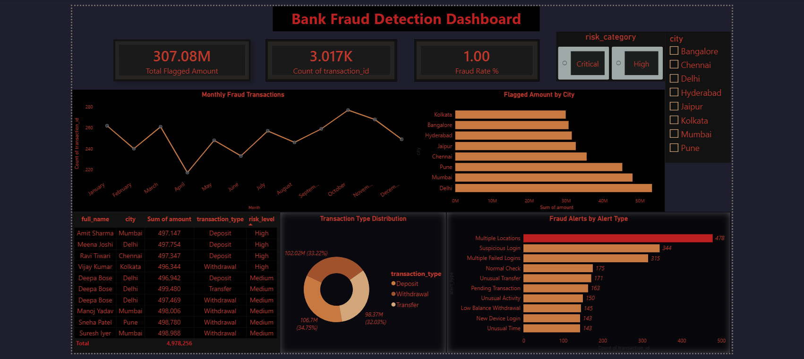
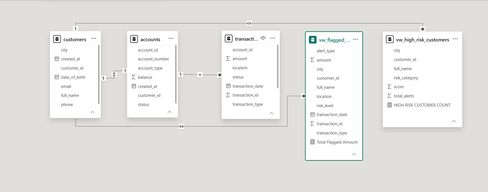

# Bank Fraud Detection — End-to-End Analytics Project


## Overview

A comprehensive **end-to-end fraud detection analytics project** built with advanced SQL, Python data engineering, and interactive Power BI dashboards. This project demonstrates a complete data pipeline from raw transaction data to actionable business intelligence, incorporating percentile-based fraud scoring and dynamic cross-filtering analytics.

**Fraud Detection Rate:** 1.00% of 85,000+ transactions flagged  
**Dataset:** 85K transactions | 50K login logs | 522 customers | 4 alert types

---

## 🎯 Project Features

### SQL Layer
- **43+ advanced SQL queries** including:
  - Common Table Expressions (CTEs) for complex aggregations
  - Database views for simplified data access (`vw_flagged_transactions`, `vw_high_risk_customers`)
  - Stored procedures for bulk operations
  - Indexes for query optimization
  - Transaction-level fraud detection logic

### Python Layer
- **Bulk data generation:** 85K realistic transactions with geographic variation
- **Exploratory Data Analysis (EDA):** percentile-based fraud scoring
  - 99th percentile: ~₹490K (top 1% = 850 transactions)
  - 99.9th percentile: ~₹498,826 (critical tier = 85 transactions)
- **Customer and login log generation** with realistic patterns

### Power BI Layer
- **Star schema data model** with fact and dimension tables
- **Interactive dashboard** featuring:
  - KPI cards: Total Flagged Amount (₹307M), Transaction Count (3,017), Fraud Rate (1.00%)
  - Trend line: Monthly fraud transaction patterns
  - Geographic analysis: Flagged amount by city (bar chart)
  - Transaction type distribution (donut chart)
  - Alert type breakdown (donut chart with counts)
  - Top 10 highest-value flagged transactions (table with conditional formatting)
- **Dynamic cross-filtering:** City and risk category slicers update all visuals in real-time
- **DAX measures:** Advanced calculations for fraud metrics and KPIs
- **Bidirectional relationships** for seamless filtering across views

### Excel Layer
- **Executive summary** with pivot tables and charts
- **KPI dashboard:** Total Flagged Amount, Transaction Count, Fraud Rate %
- **Conditional formatting:** Red highlighting for flagged transactions
- **Review Flag formulas:** Automatic flagging of high-value transactions (>₹500K)
- **Interactive slicers** for city, risk level, and alert type filtering

---

## 📊 Project Structure

```
bank-fraud-detection-dashboard/
│
├── sql/
│   └── Fraud_Detection_queries.sql       # 43+ queries, views, triggers, procedures
│
├── python/
│   ├── generate_bulk_data.py             # 85K transaction data generation
│   ├── generate_more_customers.py        # Customer and account data
│   └── eda_analysis.py                   # Percentile-based fraud scoring analysis
│
├── powerbi/
│   └── Fraud_detection.pbix              # Interactive analytics dashboard
│
├── excel/
│   ├── Fraud_Dashboard_Summary.xlsx      # Executive summary with pivot tables
│   └── Flagged_Transactions.csv          # Raw flagged transaction export
│
├── images/
│   ├── Bank_Fraud_Detection_Dashboard.png    # Power BI dashboard screenshot
│   └── Bank_Fraud_Detection_Data_Model.png   # Star schema data model diagram
│
└── README.md                             # This file
```

---

## 🗄️ Database Schema (Star Schema)

### Fact Table
- **transactions** (85K rows)
  - transaction_id (PK), account_id (FK), amount, transaction_type, location, transaction_date

### Dimension Tables
- **customers** (522 rows) — customer profiles, cities, demographics
- **accounts** (522 rows) — account details, customer relationships
- **fraud_alerts** — risk levels, alert types, flagged customer records

### Key Views
- **vw_flagged_transactions** — all transactions linked to fraud alerts with customer context
- **vw_high_risk_customers** — customers classified as High/Critical risk

---

## 🔑 Key Concepts & Technical Highlights

### SQL
- **CTEs:** Simplified complex multi-stage queries for fraud trend analysis
- **Window Functions:** Rank and partition fraud alerts by customer and amount
- **Indexes:** Optimized queries on large transaction tables for sub-second performance
- **Stored Procedures:** Bulk insert and fraud alert logging automation

### Python
- **Percentile-based thresholding:** Overcame limitations of standard deviation (which gave 0 results due to outlier distribution)
- **Data validation:** Ensured 85K rows loaded without duplication
- **EDA insights:** Identified city-wise transaction patterns (uniform ~₹99.8K average due to random generation)

### Power BI
- **Star schema design:** Enables efficient cross-dimensional filtering without performance loss
- **Bidirectional relationships:** Risk category slicer filters transaction-level facts through customer dimension
- **DAX measures:** DISTINCTCOUNT to eliminate view-join duplicates in fraud rate calculation
- **Conditional formatting:** Visually highlights anomalies (top 10 transactions, risk levels)

### Data Quality
- Addressed view-join duplicates: `vw_flagged_transactions` grouped fraud_alerts by customer to prevent row multiplication
- Corrected fraud rate formula: Changed from COUNTROWS to DISTINCTCOUNT(transaction_id) for accuracy

---

## 📈 Dashboard Walkthrough

### Power BI Dashboard (`/powerbi/Fraud_detection.pbix`)

**Layout:**
1. **KPI Row:** Total Flagged Amount, Transaction Count, Fraud Rate %
2. **Trend Analysis:** Monthly fraud transaction count over time
3. **Geographic View:** Flagged amount by city (Mumbai, Delhi, Bangalore, etc.)
4. **Transaction Breakdown:** Pie chart of Deposit/Withdrawal/Transfer distribution
5. **Alert Analysis:** Count of transactions by alert type (Multiple Locations, Suspicious Login, etc.)
6. **Interactive Filters:** City and Risk Category slicers with cross-filtering
7. **Detail Table:** Top 10 highest-value flagged transactions with customer name, amount, type, risk level

**Color Scheme:** Black/charcoal background with amber/orange accents (fraud alert theme)

### Excel Summary (`/excel/Fraud_Dashboard_Summary.xlsx`)

**Executive Summary Sheet:**
- KPI cards mirroring Power BI (300M+ flagged, 1% fraud rate)
- Pivot table: fraud breakdown by city and transaction type
- Clustered column chart: flagged amount by city
- Pie chart: transaction type distribution
- Interactive slicers for quick filtering

**Raw Data Sheet:**
- Complete flagged transaction export
- Review Flag column: auto-flagged transactions >₹500K
- Conditional formatting: red for flagged, green for OK

---

## 🚀 How to Use

### Prerequisites
- MySQL Server (5.7+)
- Python 3.8+
- Power BI Desktop (for viewing `.pbix` file)
- Microsoft Excel (for viewing `.xlsx` file)

### Setup

1. **Database Setup (SQL)**
   ```bash
   mysql -u root -p
   source sql/Fraud_Detection_queries.sql
   ```
   - Creates `fraud_detection` database
   - Builds all tables, views, and indexes
   - Loads initial customer/account data

2. **Generate Data (Python)**
   ```bash
   python python/generate_bulk_data.py
   python python/generate_more_customers.py
   ```
   - Generates 85K transactions, 50K login logs
   - Populates customers and accounts tables

3. **Analyze Data (Python)**
   ```bash
   python python/eda_analysis.py
   ```
   - Runs percentile-based fraud scoring
   - Outputs fraud flagging results

4. **View Dashboards**
   - **Power BI:** Open `powerbi/Fraud_detection.pbix` → connect to MySQL `fraud_detection` database
   - **Excel:** Open `excel/Fraud_Dashboard_Summary.xlsx` → interact with pivot tables and slicers

---

## 📊 Sample Insights

- **1% of all transactions flagged** as fraudulent (1 in 100)
- **₹307 million total flagged** across all suspicious transactions
- **Top alert type:** Multiple Locations (344 transactions)
- **Geographic hotspot:** Mumbai (highest flagged amount)
- **Top 10 fraudsters:** Single customer may have 2-3 transactions in high-value list (legitimate, not duplication)

---

## 💡 Interview Talking Points

1. **Data Quality Issue Solved:** Initially saw 80%+ fraud rate due to many-to-many join in views. Root-caused the problem (fraud_alerts grouped by customer, inflating row count), fixed with GROUP BY and DISTINCTCOUNT.

2. **Threshold Selection:** Standard deviation method flagged 0 transactions (outliers skewed distribution). Switched to percentile-based approach (99th = 1%, 99.9th = critical tier), which is more robust for financial data.

3. **Star Schema Design:** Built fact-dimension model enabling dynamic cross-filtering without performance loss — slicing by city/risk instantly updates all 8 visuals via bidirectional relationships.

4. **Full Pipeline Ownership:** Owned all layers — SQL complex queries (CTEs, views, indexes), Python data generation and EDA, Power BI modeling and DAX, Excel pivot tables and formulas — demonstrates end-to-end analytical capability.

5. **Technical Problem-Solving:** Resolved Power BI formula error (COUNTROWS vs DISTINCTCOUNT), debugged view join logic, optimized SQL indexes for 85K row scans.

---

## 🛠️ Technologies & Skills

**SQL:** MySQL, CTEs, Window Functions, Stored Procedures, Indexing, Views  
**Python:** Pandas, NumPy, Data Generation, Statistical Analysis, EDA  
**Power BI:** Data Modeling (star schema), DAX, Interactive Dashboards, Cross-Filtering  
**Excel:** Pivot Tables, Conditional Formatting, VLOOKUP, Formulas, Slicers  
**Database Design:** Relational modeling, Cardinality, Dimension/Fact Tables  

---

## 📸 Screenshots

### Power BI Dashboard
 

### Data Model (Star Schema)


---

## 📚 Learning Outcomes

✅ Advanced SQL: CTEs, window functions, stored procedures, performance optimization  
✅ Data Engineering: Bulk data generation, data validation, pipeline automation  
✅ Analytics & BI: Dashboard design, DAX measures, cross-dimensional filtering  
✅ Data Storytelling: KPIs, visual hierarchy, theme consistency (Starbucks-style polish)  
✅ Problem-Solving: Debugging data quality issues, choosing appropriate statistical methods  

---

## 📝 Notes

- **Dataset:** Synthetically generated for learning purposes (realistic patterns, no actual fraud cases)
- **Performance:** Optimized for 85K rows; scalable architecture for millions of transactions
- **Security:** Database credentials stored locally; use environment variables for production

---

## 👤 Author

**Akshay R**  
Data Analyst | B.E. Electronics & Communication Engineering (2026)  
Chennai, India | [GitHub](https://github.com/AkshayR-analyst) | [LinkedIn](https://www.linkedin.com/in/akshayR-analyst)

---

## 📄 License

This project is open-source and available for educational and portfolio purposes.

---

**Last Updated:** August 6, 2026
